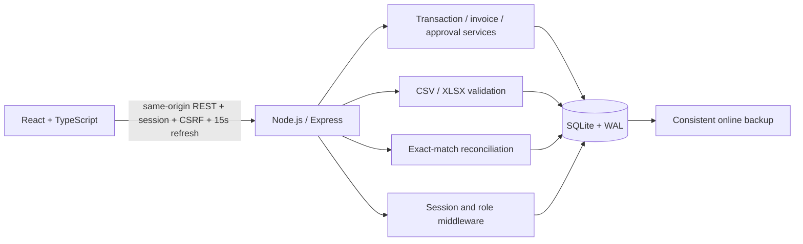
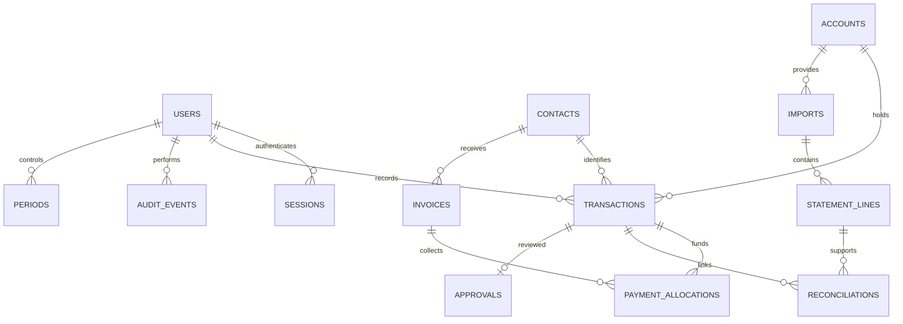

# Architecture and API

The backend uses JavaScript ES modules with built-in SQLite; the React frontend uses TypeScript. Backend TypeScript is deferred, as the prompt makes it a recommended implementation choice. The initial modular monolith keeps the schema, app services, seed, backup and entry point in separate files. HTTP routes currently share one app module and can be extracted into domain routers as scope grows.

Reconciliation history permits repeated decisions but partial unique indexes enforce at most one active link per transaction and statement line. Full many-to-many allocation is later work. Exact-match suggestions are derived from retained source rows and fixed rule `exact-reference-amount-date-v1`; confirmation retains that rule and a reviewer reason.

## Role matrix

| Action                   | Admin | Manager                | Finance | Cashier                       | Auditor |
| ------------------------ | ----- | ---------------------- | ------- | ----------------------------- | ------- |
| Financial read/reports   | All   | All                    | All     | Own receipts only; no exports | All     |
| Record receipts          | No    | Yes                    | Yes     | Yes                           | No      |
| Record outflows          | No    | Yes                    | Yes     | No                            | No      |
| Approve/reject outflows  | No    | Different creator only | No      | No                            | No      |
| Reverse accepted entries | No    | Yes, with constraints  | No      | No                            | No      |
| Import/confirm/reconcile | No    | Yes                    | Yes     | No                            | No      |
| Create contacts/invoices | No    | Yes                    | Yes     | No                            | No      |
| Create accounts          | Yes   | Yes                    | Yes     | No                            | No      |
| Close/reopen periods     | No    | Yes                    | No      | No                            | No      |
| Users/organisation name  | Yes   | No                     | No      | No                            | No      |
| Own password change      | Yes   | Yes                    | Yes     | Yes                           | Yes     |

## API overview

The Profile page is available to every signed-in role through the sidebar and header avatar. `PATCH /api/profile` accepts only `{ "name": "Full name" }`, validates a non-empty name up to 200 characters, updates the session user's own record and writes a `user.profile` audit event atomically. It uses the existing session and CSRF middleware. Email, role, active status and another user's ID cannot be updated through this endpoint. The profile shows current role/approval access and uses the existing `/api/password` operation; password change revokes all sessions. The UI requires matching new-password confirmation before submitting. Browser workflow testing remains paused; this profile addition has build and source validation only.

The app defaults to an empty company database and a one-time setup screen. A separate demo database is explicitly labelled. `POST /api/setup` requires an anonymous session's CSRF token, a company name and distinct owner/administrator identities; it refuses to run after any user exists. Production setup additionally requires the server's `SETUP_TOKEN`. It inserts no financial/reference records. `GET /api/session` reports setupRequired, setupTokenRequired and workspaceMode alongside the session information.

Visible views poll their current queries every 15 seconds and refresh on window focus, showing the last successful sync time. This synchronizes saved application records between sessions, not external provider transactions. Bank/mobile money evidence still requires authorized statement imports until official API integrations are added.

All monetary JSON fields returned by the API are integer minor-unit strings. Transaction input amounts are decimal strings such as `"123.45"`. All API writes require the `x-csrf-token` returned by `GET /api/session`, plus the session cookie. Login returns a rotated token; update it after login. Error responses are `{ "error": "Human-readable message" }`.

| Endpoint                                              | Purpose                                                            |
| ----------------------------------------------------- | ------------------------------------------------------------------ |
| GET /api/session                                      | Current identity and CSRF token; anonymous session if signed out   |
| POST /api/login, /api/logout, /api/password           | Authentication lifecycle                                           |
| GET /api/master                                       | Organisation, accounts and contacts                                |
| POST /api/accounts, /api/contacts                     | Create reference records                                           |
| GET /api/transactions                                 | Register; page size 15; filters q/account/from/to/direction/status |
| POST /api/transactions                                | Record; required request_key ensures safe retries                  |
| POST /api/transactions/:id/reverse                    | Manager reversal with date/reason; no silent updates               |
| GET /api/overview                                     | Filtered totals, chart data, account movements and recent entries  |
| GET /api/invoices                                     | Invoices with paid minor units and derived status                  |
| POST /api/invoices                                    | Create simple customer invoice                                     |
| POST /api/invoices/:id/allocate                       | Link receipt using transaction_id and decimal amount               |
| GET /api/approvals                                    | Pending outflows                                                   |
| POST /api/approvals/:id                               | Decision approved/rejected with reason                             |
| POST /api/imports/preview                             | Multipart file, account_id, mapping JSON                           |
| GET /api/imports, /api/imports/:id                    | History and retained preview/errors                                |
| GET /api/imports/:id/source                           | Authorized original evidence download                              |
| POST /api/imports/:id/commit                          | Commit valid preview rows once                                     |
| GET /api/reconciliation                               | Statement lines, suggestions, evidence and exceptions              |
| POST /api/reconciliation                              | Confirm exact suggestion with line_id, transaction_id, reason      |
| POST /api/reconciliation/:id/undo                     | Retain history and undo active link with reason                    |
| GET /api/reports/export                               | Filtered transaction export; format=csv or pdf                     |
| GET /api/audit                                        | Latest 200 audit events                                            |
| GET /api/settings, PATCH /api/settings                | Organisation/period read; admin name change                        |
| POST /api/periods                                     | Manager month, boolean closed, reason                              |
| GET /api/users, POST /api/users, PATCH /api/users/:id | Admin user list/create/status                                      |

The SQLite database, not frontend state, is the financial source of truth. Account channel determines payment channel; account provider scopes references. Approval and reconciliation statuses are independent. Manual evidence review is explicitly labelled evidence_verified and remains distinct from statement reconciliation. Provider API confirmation and external payment settlement are not connected.

## Additive enhancement modules

`server/enhancements.js` provides shared exact document/balance/report/analytics services and added reference, evidence, supplier, exception and control routes. `server/partial-matching.js` provides atomic reviewed partial evidence allocations. Existing exact matching endpoints remain; grouped/partial flows are additive and cannot bypass original locks, acceptance/reversal or duplicate controls. `server/restore.js` restores a verified snapshot into a new file only. `src/Enhancements.tsx` connects added operational controls using the existing form/API conventions.

| Additive endpoints                                                                         | Purpose                                                       |
| ------------------------------------------------------------------------------------------ | ------------------------------------------------------------- |
| PATCH /api/users/:id, /api/accounts/:id, /api/contacts/:id                                 | Audited maintenance; session revocation for user changes      |
| GET /api/contacts/:id/history; GET/POST/PATCH /api/categories                              | Histories and category references                             |
| GET/POST /api/transactions/:id/evidence; GET /api/evidence/:id                             | Private evidence metadata/upload/download                     |
| POST /api/transactions/:id/verify                                                          | Manual evidence review; no provider API assertion             |
| PATCH /api/invoices/:id; GET /api/invoices/:id/payments; POST /api/allocations/:id/correct | Invoice lifecycle, payment history and retained correction    |
| GET/POST /api/supplier-bills; POST /api/supplier-bills/:id/allocate                        | Supplier payables and approved allocations                    |
| GET /api/supplier-bills/:id/payments; POST /api/supplier-allocations/:id/correct           | Supplier payment history and correction                       |
| GET/PATCH /api/reconciliation/policy; GET /api/reconciliation/suggestions                  | Configured tolerance evidence suggestions                     |
| POST /api/reconciliation/suggestions/reject                                                | Audited rejection of an exact suggestion                      |
| GET /api/reconciliation/participants                                                       | Eligible transactions/lines with remaining amounts            |
| GET/POST /api/reconciliation/proposals; POST .../:id/decide; POST .../:id/undo             | Balanced groups, independent decisions and undo               |
| GET/POST /api/reconciliation/partial-proposals; POST .../:id/decide; POST .../:id/undo     | Exact minor-unit partial allocation, decision and undo        |
| GET /api/exceptions; POST /api/exceptions/review                                           | Derived queue and retained review reasons                     |
| GET/POST /api/approval-policy                                                              | Explicit payment-approval delegation by managers              |
| GET/POST /api/control-requests; POST .../:id/decide                                        | Independent adjustment/write-off/reversal/closure requests    |
| GET /api/analytics; GET /api/search                                                        | Explainable management indicators and permitted global search |
| GET /api/reports/data; GET /api/reports/download                                           | Shared report variants; CSV/XLSX/PDF                          |
| GET /api/imports/:id/errors; GET /api/backup                                               | Validation evidence and admin-only consistent snapshot        |

Financial fields remain integer minor units. `accounts.balance` retains its previous filtered-movement meaning for API compatibility. `opening`, `movement`, `closing` are explicit additional fields. Invoice `lifecycle` distinguishes draft/issued/cancelled; the legacy `unpaid` payment status means an issued invoice without receipts. A non-cash write-off has its own amount/status and never increments paid. Partial reconciliation adds display/allocated/remaining fields while retaining original monetary values and legacy unmatched/reconciled storage states.
